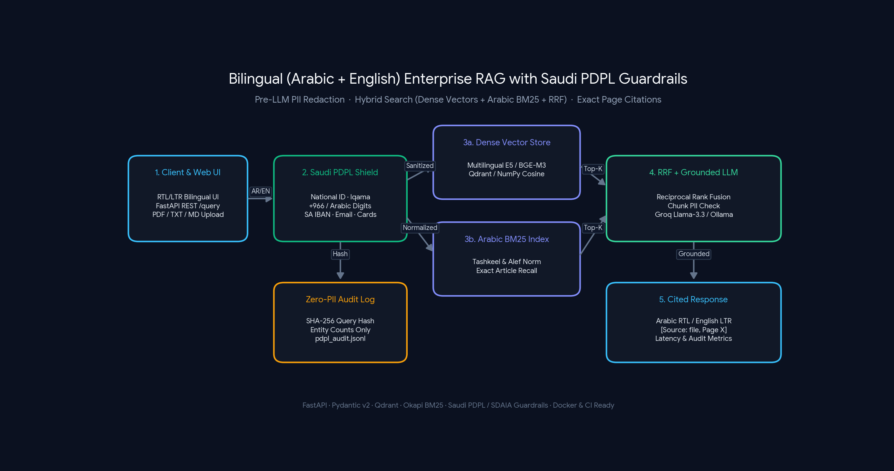
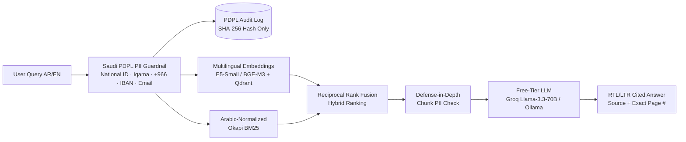

# Bilingual (Arabic + English) Enterprise RAG with Saudi PDPL Guardrails

A production-ready **Bilingual (Arabic + English) Document Q&A microservice** engineered for Saudi Arabian enterprises (HR, Legal, FinTech, and Compliance teams). It combines **Hybrid Search (Multilingual Dense Vectors + Arabic-Normalized Okapi BM25 + Reciprocal Rank Fusion)**, **exact page-level citations**, and a **pre-LLM Saudi PDPL / SDAIA PII Redaction Guardrail** with cryptographic audit logging.

---

## System Architecture





---

## Key Capabilities

- **Saudi PDPL / SDAIA-Aligned PII Shield**: Automatically detects and masks Saudi National IDs (`1xxxxxxxxx`), Iqama IDs (`2xxxxxxxxx`), Saudi mobile/landline numbers (`+966`, `00966`, `05X`, including Arabic-Indic digits `٠٥...`), Saudi IBANs (`SA...`), emails, Luhn-verified payment cards, passports, and IP addresses **before** prompts or retrieved chunks leave your boundary.
- **Zero-PII Compliance Audit Trail**: Persists redaction telemetry (`pdpl_audit.jsonl`) using SHA-256 hashes of sanitized queries—raw PII is never logged.
- **Bilingual Hybrid Search (Vector + BM25 + RRF)**:
  - **Arabic NLP Normalization**: Strips Tashkeel/diacritics, Tatweel, normalizes Alef (`أ إ آ -> ا`), Teh Marbuta (`ة -> ه`), Alef Maksura (`ى -> ي`), and Arabic-Indic numerals (`٠-٩ -> 0-9`).
  - **Dense Semantic + Lexical Fusion**: Captures conceptual meaning via multilingual embeddings (`intfloat/multilingual-e5-small` or `BAAI/bge-m3`) while preserving exact match recall for legal article numbers (e.g., `Article 77`, `المادة 84`).
- **Exact Page-Level Citations**: Every PDF and multi-page text document is chunked page-by-page so every claim cites `[Source: filename, Page X]`.
- **Full-Stack Ready**: FastAPI REST backend with OpenAPI Swagger docs (`/docs`) + built-in responsive **RTL/LTR Bilingual Web UI** (`/`) featuring live PII Shield banners, a PDPL PII Sandbox, and an Audit Log viewer.
- **100% Free-Tier Friendly**: Runs on **Groq Free Tier** (`llama-3.3-70b-versatile`) or local **Ollama**, with 1-click free live hosting on **Hugging Face Spaces (16GB RAM Docker)** or **Render (512MB Free Tier)**.

---

## Project Structure

```text
bilingual-rag-pdpl-ksa/
├── app/
│   ├── main.py                     # FastAPI app factory, lifespan, UI static serving
│   ├── api/routes.py               # REST endpoints (/health, /upload, /query, /pii/redact, /audit/logs)
│   ├── core/config.py              # Environment-driven Settings (.env)
│   ├── models/schemas.py           # Strict Pydantic v2 request/response models
│   └── services/
│       ├── arabic_utils.py         # Arabic normalization, digit conversion, language detection
│       ├── pii_guardrail.py        # Saudi PDPL PII detector + optional Microsoft Presidio
│       ├── audit_logger.py         # Zero-PII SHA-256 JSONL compliance audit logger
│       ├── document_processor.py   # Page-aware PDF / TXT / MD parser & overlapping chunker
│       ├── embeddings.py           # SentenceTransformers / HF Inference API / Local Hash
│       ├── hybrid_retriever.py     # Qdrant + NumPy Vector + Okapi BM25 + RRF fusion
│       ├── llm_client.py           # Groq Free Tier + Ollama + Extractive fallback
│       └── rag_pipeline.py         # End-to-end RAG + PDPL orchestration
├── frontend/index.html             # Responsive RTL/LTR Web UI (Tailwind CDN, zero build step)
├── sample_docs/                    # Bundled Arabic + English Saudi Labor Law & HR Policy docs
├── docs/architecture_diagram.png   # System architecture diagram
├── tests/test_rag_pipeline.py      # Automated unit & API integration tests
├── Dockerfile                      # Hugging Face Spaces (port 7860) & local Docker image
├── docker-compose.yml              # FastAPI + Qdrant local stack
├── render.yaml                     # Render.com 512MB free-tier blueprint
├── A_TO_Z_GUIDE.md                 # Complete beginner-to-deployment walkthrough
└── .github/workflows/ci.yml        # GitHub Actions CI test pipeline
```

---

## Quick Start (Local in 3 Minutes)

```bash
# 1. Create virtual environment
python -m venv .venv
source .venv/bin/activate        # Windows: .venv\Scripts\activate

# 2. Install dependencies
pip install -r requirements.txt  # Or requirements-lite.txt for fast lightweight install

# 3. Configure environment
cp .env.example .env
# Edit .env and paste your FREE Groq API Key from https://console.groq.com/keys

# 4. Run the server
uvicorn app.main:app --reload --port 7860
```

Open **http://localhost:7860** for the Bilingual Web UI, or **http://localhost:7860/docs** for interactive Swagger API docs.

### Run with Docker Compose (FastAPI + Qdrant)

```bash
cp .env.example .env
docker compose up --build
```

---

## Free Live Hosting Options

### Option A: Hugging Face Spaces (Recommended — 16GB RAM, 2 vCPU, 100% Free)
1. Create a new Space on [huggingface.co/new-space](https://huggingface.co/new-space) and select **Docker -> Blank**.
2. Push this repository (or upload files) to the Space.
3. In Space **Settings -> Variables and secrets**, add Secret `GROQ_API_KEY` with your free Groq key.
4. Your live Bilingual RAG URL will be up in ~3 minutes on port `7860` with full local multilingual embeddings (`intfloat/multilingual-e5-small` or `BAAI/bge-m3`).

### Option B: Render.com Free Tier (512MB RAM)
1. Push this repo to GitHub and click **New -> Blueprint** on Render.
2. Render automatically reads `render.yaml` (uses `requirements-lite.txt` + `EMBEDDING_PROVIDER=huggingface_api` for <150MB RAM).
3. Add `GROQ_API_KEY` and free `HF_API_TOKEN` in Render environment variables.

---

## API Endpoints

| Method | Endpoint | Description |
| :--- | :--- | :--- |
| `GET` | `/health` | Readiness check, active LLM/embedding/vector backend, chunk count |
| `POST` | `/api/v1/documents/upload` | Upload Arabic/English `.pdf`, `.txt`, or `.md` with page tracking |
| `POST` | `/api/v1/documents/load-sample` | Index bundled Bilingual Saudi Labor Law & HR Policy samples |
| `GET` | `/api/v1/documents` | List indexed documents and metadata |
| `DELETE` | `/api/v1/documents/{doc_id}` | Remove document from Vector + BM25 indices |
| `POST` | `/api/v1/query` | Run PDPL-protected Hybrid Search RAG Q&A with exact page citations |
| `POST` | `/api/v1/pii/redact` | Standalone Saudi PDPL PII redaction test endpoint |
| `GET` | `/api/v1/audit/logs` | View zero-PII SHA-256 PDPL compliance audit records |

---

## Running Tests

```bash
EMBEDDING_PROVIDER=local_hash USE_QDRANT=false pytest -v
```

---

## 2-Minute Demo Walkthrough Script

1. **0:00–0:20 (Hook)**: Open the live URL. Show the pre-loaded Arabic + English Saudi Labor Law documents and explain why naive RAG fails on Arabic PDFs and leaks PII.
2. **0:20–0:55 (Live PDPL Demo)**: Click the **"PDPL Test: Query with Live PII"** button (contains Iqama, `+966` phone, IBAN, and email). Point out the green **PDPL Guardrail Banner** showing all 4 sensitive fields redacted *before* reaching Groq Llama-3.3-70B, plus the exact `[Page 2]` citation.
3. **0:55–1:30 (Arabic RTL + Hybrid Search)**: Click the **Arabic Ramadan / Article 77** button with Arabic-Indic ID digits (`١٠٩٨٧٦٥٤٣٢`). Show RTL Arabic answer, Arabic digit redaction, and expand a retrieved citation to highlight Vector + BM25 + RRF scores.
4. **1:30–2:00 (Enterprise Governance)**: Open the **PDPL Audit Log** tab (SHA-256 hashes, zero raw PII stored) and briefly show `/docs` Swagger UI + GitHub Actions green CI badge.
# bilingual-rag-pdpl-ksa
